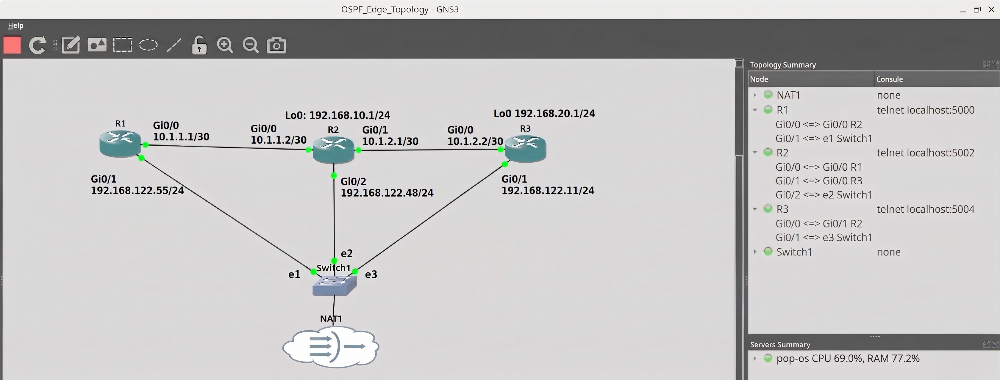

# Cisco OSPF Edge Topology Automation with Ansible & GNS3

🌍 *Choose language:* [English](#-english-version) | [Bahasa Indonesia](#-versi-indonesia)

---

## 🇬🇧 English Version

This project automates the configuration and deployment of a 3-router Cisco network topology (Edge, Internal Backbone, and End Router) using **Ansible** and **GNS3** on **Pop!_OS Linux**.

It demonstrates **Infrastructure as Code (IaC)** best practices by decoupling the *Management Plane* (Out-of-Band SSH via NAT/Switch) from the *Data Plane* (OSPF Area 0), featuring dynamic default route propagation.

---

### 📐 Network Topology & Execution


*Figure 1: GNS3 Network Topology Setup*

---

### 🛠️ Key Features

- **Multi-Play Architecture:** Modular playbooks targeting R1 (Edge), R2 (Backbone), and R3 (End Router).
- **Dynamic Default Route Injection:** Automatically propagates `0.0.0.0/0` via `default-information originate` from R1.
- **Idempotent Deployment:** Enforces state consistency using `match: exact` to eliminate obsolete routing lines.
- **Legacy SSH Algorithm Handling:** Configures `ansible_ssh_common_args` to negotiate key exchange algorithms (`diffie-hellman-group14-sha1`) between modern OpenSSH and Cisco IOS.

---

### 📁 Directory Structure

```text
OSPF-Edge-Topology/
├── ansible.cfg              # Ansible configuration & SSH parameters
├── inventory/
│   └── hosts.ini            # Management IPs & SSH host variables
├── playbooks/
│   └── deploy_topology.yml  # OSPF & interface automation playbook
├── assets/                  # Screenshot files for documentation
└── README.md
```

---

### 🚀 Getting Started

1. **Clone the Repository:**
   ```bash
   git clone [https://github.com/fjrngrh/OSPF-Edge-Topology.git](https://github.com/fjrngrh/OSPF-Edge-Topology.git)
   cd OSPF-Edge-Topology
   ```

2. **Test Connectivity:**
   ```bash
   ansible routers -m ping
   ```

3. **Run Dry-Run (Simulation):**
   ```bash
   ansible-playbook playbooks/deploy_topology.yml --check --diff
   ```

4. **Deploy to Routers:**
   ```bash
   ansible-playbook playbooks/deploy_topology.yml
   ```

---

## 🇮🇩 Versi Indonesia

Proyek ini mengotomatiskan *deployment* jaringan 3 *router* Cisco (Edge, Internal Backbone, dan End Router) menggunakan **Ansible** dan **GNS3** pada lingkungan **Pop!_OS Linux**.

Arsitektur ini menerapkan prinsip **Infrastructure as Code (IaC)** dengan memisahkan *Management Plane* (Out-of-Band SSH via NAT/Switch) dan *Data Plane* (OSPF Area 0), serta menyuntikkan *default route* secara dinamis ke seluruh domain *routing*.

---

### 📐 Topologi Jaringan & Hasil Eksekusi


*Gambar 1: Topologi GNS3 (Data Plane OSPF & Management Plane NAT)*

---

### 🛠️ Fitur Utama & Spesifikasi

- **Multi-Play Architecture:** Menyediakan alur kerja modular untuk R1 (Edge), R2 (Backbone), dan R3 (End Router).
- **Dynamic Default Route Injection:** Menyebarkan rute `0.0.0.0/0` secara otomatis via perintah `default-information originate` pada R1.
- **Konfigurasi Idempoten:** Memanfaatkan parameter `match: exact` untuk menjaga ketersediaan konfigurasi sesuai sumber kebenaran (*Single Source of Truth*).
- **Legacy SSH Compatibility:** Menangani enkripsi pertukaran kunci SSH *legacy* (`diffie-hellman-group14-sha1`) antara OpenSSH Pop!_OS modern dan Cisco IOS.

---

### 📁 Struktur Direktori

```text
OSPF-Edge-Topology/
├── ansible.cfg              # Konfigurasi Ansible & parameter SSH
├── inventory/
│   └── hosts.ini            # IP Management router & variabel SSH
├── playbooks/
│   └── deploy_topology.yml  # Playbook otomatisasi OSPF & Interface
├── assets/                  # Folder gambar dokumentasi README
└── README.md
```

---

### 🚀 Cara Penggunaan

1. **Clone Repositori:**
   ```bash
   git clone [https://github.com/fjrngrh/OSPF-Edge-Topology.git](https://github.com/fjrngrh/OSPF-Edge-Topology.git)
   cd OSPF-Edge-Topology
   ```

2. **Uji Konektivitas SSH:**
   ```bash
   ansible routers -m ping
   ```

3. **Simulasi Eksekusi (Dry-Run):**
   ```bash
   ansible-playbook playbooks/deploy_topology.yml --check --diff
   ```

4. **Eksekusi Konfigurasi ke Router:**
   ```bash
   ansible-playbook playbooks/deploy_topology.yml
   ```